<a name="top"></a>
<div align="center">

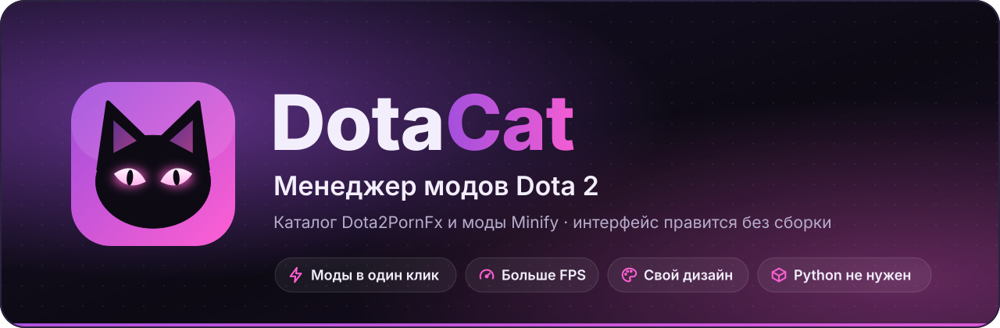

<br>


<br><br>

Менеджер модов Dota 2 для каталога [Dota2PornFx](https://h6rd.github.io/Dota2PornFxWeb/).<br>
Работает так же, как плагин D2PFX в [Minify](https://github.com/Egezenn/dota2-minify), но весь интерфейс —<br>
обычные HTML/CSS/JS-файлы, которые можно менять как угодно, без сборки.

**[Возможности](#features)** · **[Скриншоты](#screenshots)** · **[Установка](#install)** ·
**[Как пользоваться](#usage)** · **[Дизайн](#design)** · **[Структура](#structure)** · **[Важно](#important)**

<br>

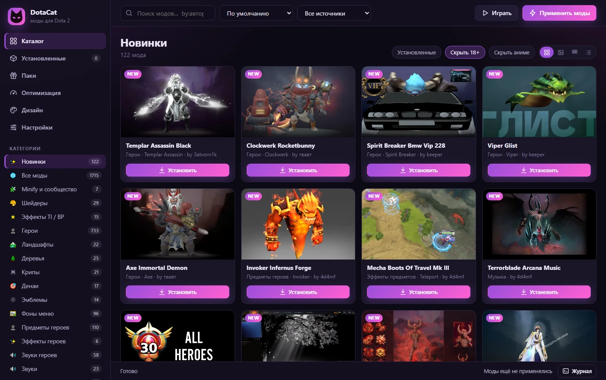

</div>

<br>

<a name="features"></a>
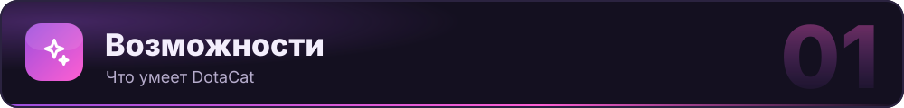

<table>
  <tr>
    <td width="33%" valign="top">
      <h3>🛒 Каталог в один клик</h3>
      Больше 1700 модов Dota2PornFx по категориям: поиск, сортировка, фильтры 18+ и аниме, стили модов и превью.
    </td>
    <td width="33%" valign="top">
      <h3>🦸 Моды по героям</h3>
      Сетка героев: скины, предметы, звуки, эффекты и иконки одного героя в одном месте.
    </td>
    <td width="33%" valign="top">
      <h3>🧩 Minify и сообщество</h3>
      Моды из Minify и реестра Dota-Modding-Community прямо в каталоге, с меткой «ЕСТЬ ДУБЛЬ» у похожих.
    </td>
  </tr>
  <tr>
    <td valign="top">
      <h3>🧮 Порядок и конфликты</h3>
      Перетаскивайте моды мышкой: верхний важнее. Проверка совпадений найдёт дубли и конфликты.
    </td>
    <td valign="top">
      <h3>⚡ Больше FPS</h3>
      Облегчённые эффекты как в Minify, параметры запуска, графика Dota 2 и настройки Windows.
    </td>
    <td valign="top">
      <h3>🎨 Свой дизайн</h3>
      5 готовых тем, цвета, вид карточек, фон и свой CSS. Всё применяется сразу, без пересборки.
    </td>
  </tr>
  <tr>
    <td valign="top">
      <h3>🛡️ Игра цела</h3>
      Оригинальные файлы игры не меняются: все моды собираются в один <code>pak66_dir.vpk</code>.
    </td>
    <td valign="top">
      <h3>📦 Без установки</h3>
      Один <code>DotaCat.exe</code>, Python не нужен. Из исходников — только стандартная библиотека.
    </td>
    <td valign="top">
      <h3>🔒 Только локально</h3>
      Интерфейс общается с программой через сервер на <code>127.0.0.1</code> с токеном, новым при каждом запуске.
    </td>
  </tr>
</table>

<br>

<a name="screenshots"></a>
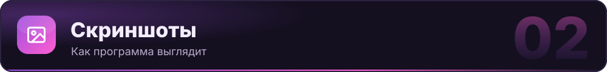

<table>
  <tr>
    <td width="50%" align="center">
      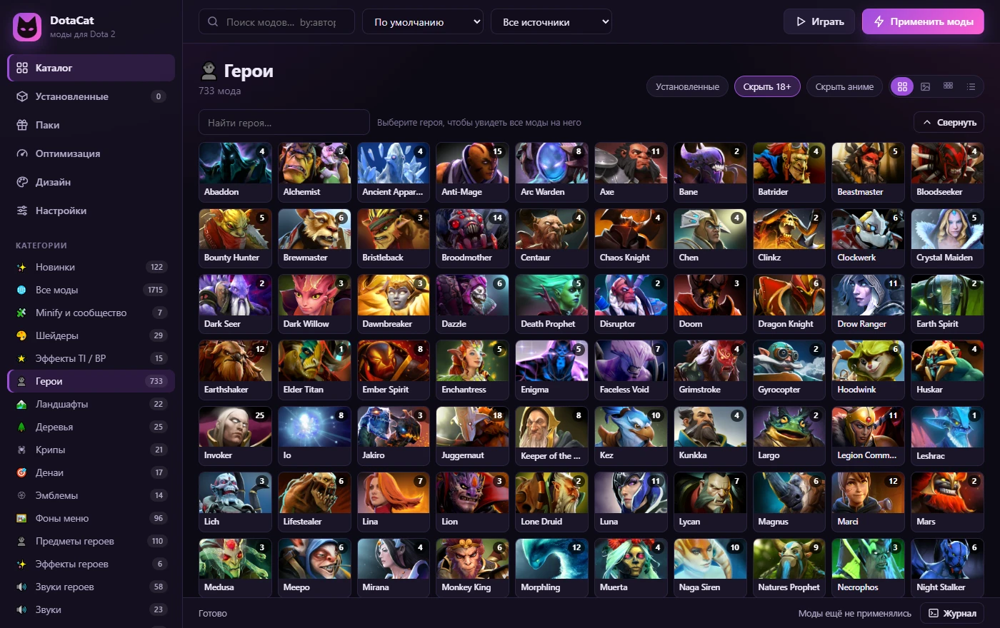<br>
      <b>Сетка героев</b><br><sub>Число на портрете — сколько модов на героя</sub>
    </td>
    <td width="50%" align="center">
      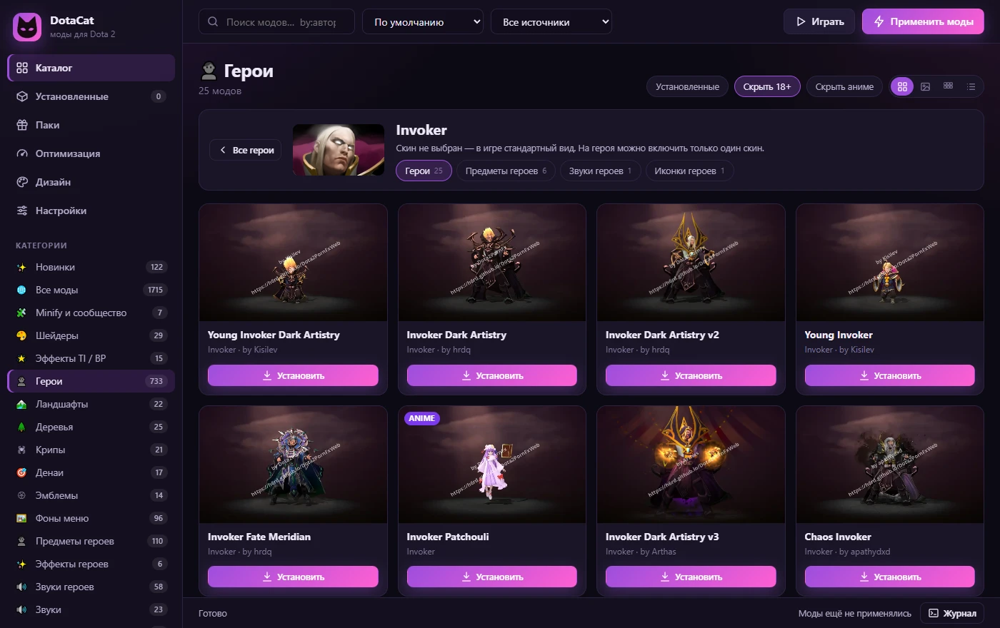<br>
      <b>Страница героя</b><br><sub>Текущий скин и переходы к предметам и звукам</sub>
    </td>
  </tr>
  <tr>
    <td align="center">
      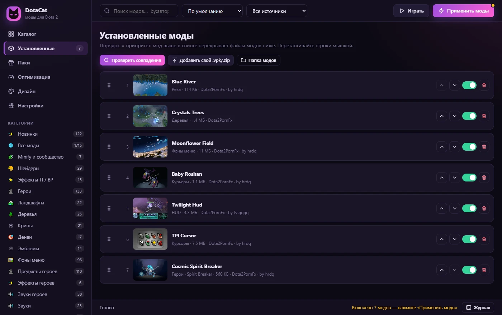<br>
      <b>Установленные</b><br><sub>Порядок = приоритет, включение одним переключателем</sub>
    </td>
    <td align="center">
      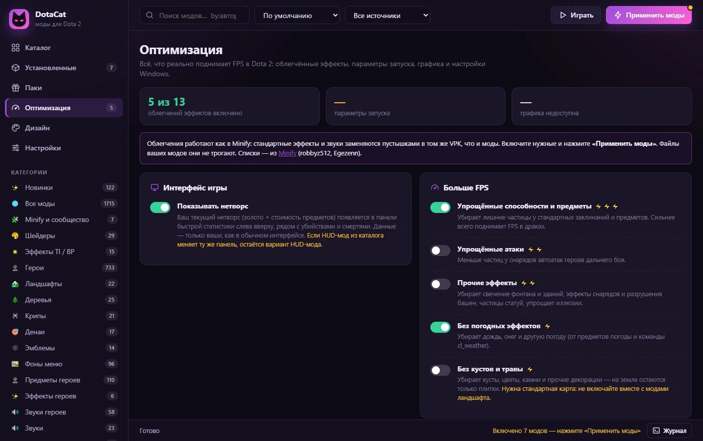<br>
      <b>Оптимизация</b><br><sub>Облегчения эффектов, параметры запуска, графика</sub>
    </td>
  </tr>
  <tr>
    <td colspan="2" align="center">
      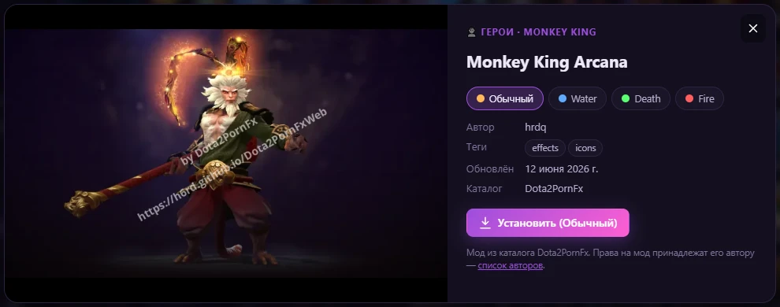<br>
      <b>Карточка мода</b><br><sub>Стили (цветные кружки), автор, теги и дата обновления</sub>
    </td>
  </tr>
</table>

<br>

<a name="install"></a>
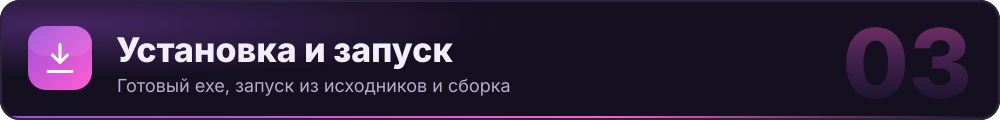

### 💾 Готовая программа

> Windows 10/11, Python не нужен.

1. Скачайте [`DotaCat.exe`](DotaCat.exe) и положите его в **отдельную папку**: рядом с ним появятся
   `ui\` (интерфейс) и `data\` (настройки и моды).
2. Дважды щёлкните `DotaCat.exe`: откроется окно программы (Edge/Chrome в режиме приложения).
3. При первом запуске программа сама найдёт Steam и Dota 2, спросит язык игры и аккаунт Steam.

### 🐍 Из исходников

> Нужен Python 3.12+. Сторонние пакеты не нужны: только стандартная библиотека.

```bash
git clone https://github.com/omgkeklol228/DotaCat.git
cd DotaCat
python -m dotacat
```

Или скачайте **Code → Download ZIP** и запустите `DotaCat.bat`, либо `DotaCat (консоль).bat`,
чтобы видеть ошибки.

### 🔨 Сборка exe

```bash
pip install pyinstaller pillow
python build.py
```

По умолчанию exe кладётся в папку `DotaCat` рядом с папкой репозитория. Свою папку можно
передать аргументом: `python build.py <папка>`.

<br>

<a name="usage"></a>


| | Шаг | Что происходит |
|:-:|---|---|
| **1** | **Каталог** → «Установить» | Мод скачивается в `data/mods`. У модов с несколькими стилями (цветные кружки) сначала выберите стиль. |
| **2** | **Установленные** | Включайте и выключайте моды, перетаскивайте строки мышкой. Чем выше мод, тем важнее: его файлы перекрывают файлы модов ниже. |
| **3** | **Применить моды** | Все включённые моды собираются в один файл `game/dota_<язык>/pak66_dir.vpk`. Оригинальные файлы игры не меняются. |
| **4** | **Настройки → Параметры запуска → «Прописать»** | Добавляет `-language <язык>` и выбранные во вкладке «Оптимизация» флаги в параметры запуска Dota 2 (Steam на пару секунд закроется). |
| **5** | **Настройки → «Убрать моды из игры»** | Удаляет собранный VPK и возвращает курсоры. Скачанные моды остаются в DotaCat. |

Свои моды: **«Установленные → Добавить свой .vpk/.zip»**.

### 🦸 Герои

В разделах «Герои», «Предметы героев», «Звуки героев», «Эффекты героев» и «Иконки героев»
сверху есть сетка героев. Нажмите на героя — останутся только моды на него, а в полосе героя
видно, какой скин сейчас стоит, и есть переходы к его предметам и звукам.

> [!NOTE]
> На одного героя можно включить только **один скин**. Если поставить второй, DotaCat спросит:
> заменить и удалить старый или заменить, оставив старый выключенным. Предметы героя конфликтуют,
> только если заменяют один слот (оружие, голова…). Если несовместимые моды оказались включены,
> при запуске программы остаётся верхний в списке, а в журнале пишется, что выключено.

### 🌐 Источники модов

| Источник | Что даёт | Проверка |
|---|---|---|
| **Dota2PornFx** | Основной каталог | SHA-256 из `mod-hashes.json`. Если GitHub не отдал файл или файл битый, используется официальное зеркало на Hugging Face. |
| **Minify** | Моды из репозитория Minify, сделанные готовыми файлами и списками пустышек: Dark Terrain, Tree Mod, Remove River, Revert Ping Sounds | — |
| **Сообщество Minify** | Реестр Dota-Modding-Community: As-Is FoW, Simple Dark Terrain, Minimize Hero Spells | Архив ставится, только если его SHA-512 совпал с реестром. |

Источники включаются и выключаются в «Настройки → Каталог». В каталоге есть раздел
«Minify и сообщество» и фильтр источника. Моды других источников помечены, а у похожих
модов из разных каталогов стоит метка «ЕСТЬ ДУБЛЬ».

<details>
<summary><b>Проверены, но не подключены</b></summary>

<br>

- **GameBanana** — моды для Dota 2 там 2014–2015 годов, под старый движок.
- **Исправления аркан `d2pfx-arcana-fixes`** — их применение завязано на логику Dota 2 Mod Manager.
- **Зеркала сайта на Vercel и Netlify** — не отдают файлы модов.

</details>

### 🔍 Проверка совпадений

- **Перед установкой**: если похожий мод уже стоит из другого источника, DotaCat предупредит.
- **«Установленные → Проверить совпадения»** сравнивает файлы игры, которые подменяет каждый мод
  (по CRC32 содержимого). В отчёте:
  - одинаковые моды (есть кнопка «оставить один»);
  - конфликты: общие файлы с разным содержимым и какой мод победит;
  - безвредные пересечения;
  - похожие моды из разных источников.

### ⚡ Оптимизация

| Раздел | Что внутри |
|---|---|
| **Нетворс** | «Оптимизация → Интерфейс игры → Показывать нетворс» (мод Show NetWorth из Minify). Ваш текущий нетворс появляется в панели быстрой статистики рядом с K/D/A. Включите его и нажмите «Применить моды». |
| **Облегчения эффектов** | Как моды Minify: упрощённые способности и атаки, прочие эффекты, погода, кусты, спреи, пинги и звуки. Стандартные файлы заменяются пустышками в том же VPK. Файлы ваших модов облегчения не трогают. |
| **Параметры запуска** | `-novid`, `+map_enable_background_maps 0` (без 3D-фона меню), `-nojoy`, `-high`, `-map dota`, `-console`, DirectX 11 / Vulkan. Отдельно перечислено, что не работает (`-threads`, `-dx9`, `-noaafonts` и т.п.). |
| **Графика** | Настройки из `Steam\userdata\<аккаунт>\570\local\cfg\video.txt` (тени, SSAO, туман, вода, Reflex, качество рендера…) и лимиты FPS в игре и в меню. Кнопка «Максимум FPS» выставляет быстрые значения. |
| **Windows и Steam** | Игровой режим, планирование GPU, электропитание, автозагрузка, оверлеи, кэш шейдеров, драйвер видеокарты. |

> [!TIP]
> Графику меняйте при закрытой игре. Исходные файлы сохраняются, и кнопка
> «Вернуть как было до DotaCat» их восстанавливает.

<details>
<summary><b>Что DotaCat делает так же, как Minify</b></summary>

<br>

- моды с картой (`maps/dota.vpk`, ландшафты TI) кладутся в `game/dota_<язык>/maps/`;
- курсоры копируются в `game/dota/resource/cursor`, а оригиналы сохраняются в `data/backup`;
- для английского языка используется папка `dota_dutch` и `-language dutch`, а тексты
  подменяются на английские («English Fix»);
- некоторые категории допускают только один включённый мод (курьеры, варды, река, музыка…),
  а у крипов, башен и эффектов предметов — один мод на группу. Лишние выключаются сами.

</details>

<br>

<a name="design"></a>
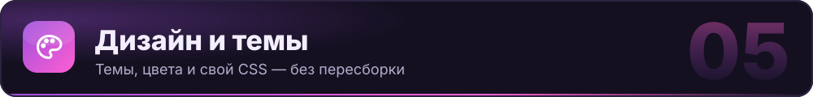

<p align="center">
  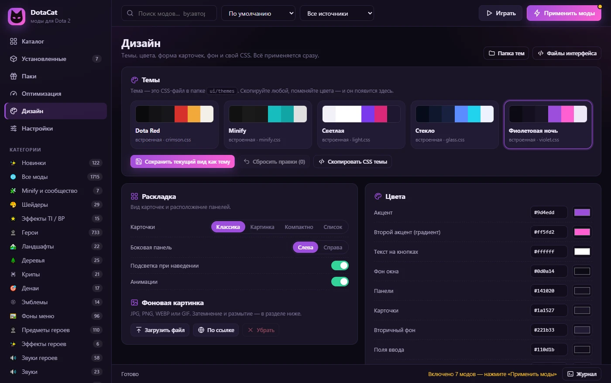
</p>

Всё применяется сразу. После правки файла нажмите **Ctrl+R** в окне программы.
Пересобирать exe не нужно: правьте файлы в папке `ui\` рядом с `DotaCat.exe`
(при запуске из исходников это папка `ui/` в корне репозитория).

<table>
  <tr>
    <td width="50%" align="center">
      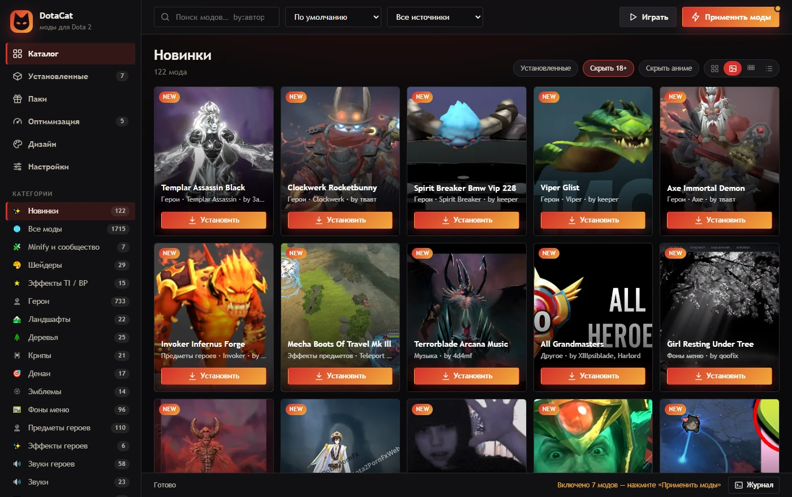<br>
      <b>Dota Red</b> · <code>crimson.css</code>
    </td>
    <td width="50%" align="center">
      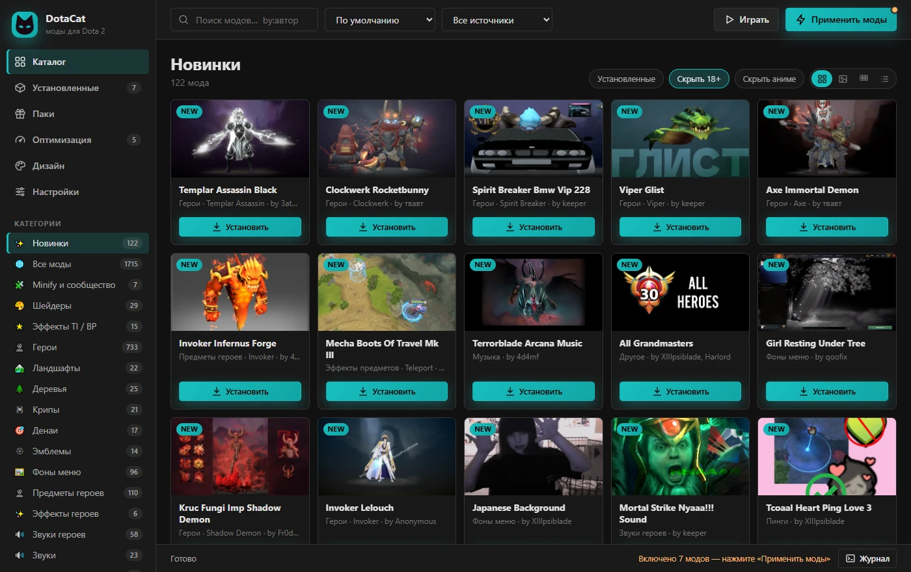<br>
      <b>Minify</b> · <code>minify.css</code>
    </td>
  </tr>
  <tr>
    <td align="center">
      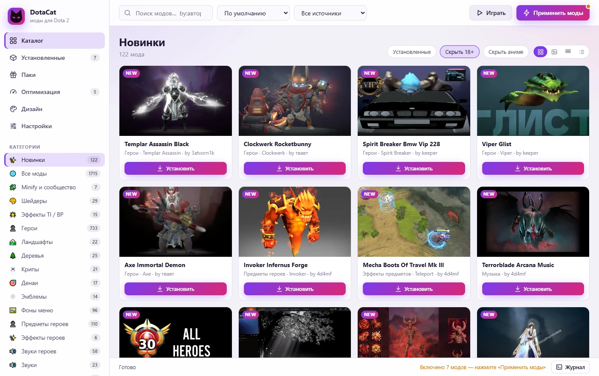<br>
      <b>Светлая</b> · <code>light.css</code>
    </td>
    <td align="center">
      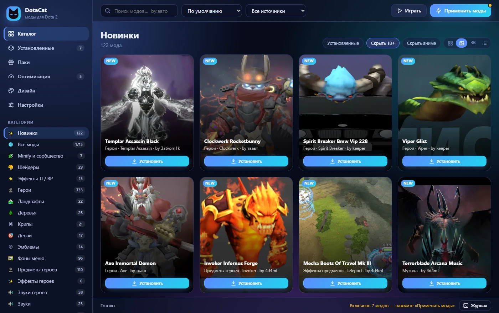<br>
      <b>Стекло</b> · <code>glass.css</code>
    </td>
  </tr>
</table>

<p align="center"><sub>На остальных скриншотах — тема по умолчанию «Фиолетовая ночь» (<code>violet.css</code>).</sub></p>

| Что | Где |
|---|---|
| Темы, цвета, скругления, размер карточек, шрифт, фон, вид карточек | вкладка **«Дизайн»** |
| Готовые темы (просто значения CSS-переменных) | `ui/themes/*.css`, новый файл = новая тема |
| Свой CSS поверх всего | `ui/custom.css` или «Дизайн → Свой CSS» |
| Все стили интерфейса | `ui/css/base.css` |
| Разметка окна (меню, панели, кнопки) | `ui/index.html` |
| Шаблоны карточек и логика | `ui/js/app.js` (функции `cardHTML`, `detailsHTML`) |
| Иконки | `ui/js/icons.js` |

Начало файла темы:

```css
/* @theme name="Моя тема" author="я" */
/* @layout card-style="overlay" sidebar="left" glow="1" anim="1" */
:root {
  --accent: #ff3366;
  --bg: #0b0b12;
  --card: #161622;
  --radius: 10px;
}
```

`card-style` бывает `classic`, `overlay`, `compact` и `list`, `sidebar` бывает `left` и `right`.
Кнопка «Сохранить текущий вид как тему» сама запишет такой файл из ваших настроек.

> [!TIP]
> Когда выходит новая версия exe, он обновляет файлы интерфейса в `ui\`. Ваши темы, `custom.css`
> и фон не трогаются. Если вы правили `base.css`, `app.js` или `index.html`, старые версии
> сохраняются в `ui\.backup-<версия>`. Поэтому свои правки лучше держать в `custom.css` и в темах.

<br>

<a name="structure"></a>
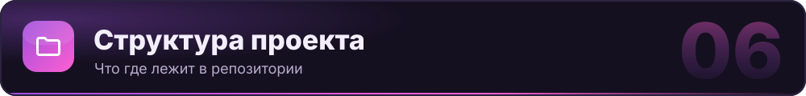

```
DotaCat.exe             готовая программа (Windows, Python не нужен)
DotaCat.py              точка входа для сборки exe
DotaCat.bat             запуск из исходников без консоли
DotaCat (консоль).bat   запуск из исходников с консолью, видно ошибки
build.py                сборка exe: pip install pyinstaller pillow, затем python build.py
tools/make_icon.py      рисует иконку (assets/dotacat.ico, ui/img/icon.svg, ui/img/cat.svg)
assets/                 иконка программы
docs/                   скриншоты и картинки для этого README
dotacat/                программа (Python, только стандартная библиотека)
  catalog.py            каталог Dota2PornFx (как в Minify: ветка data репозитория)
  library.py            установка, включение, порядок, конфликты
  patcher.py            сборка VPK, курсоры, карты, English Fix
  optimize.py           облегчения эффектов, нетворс, параметры запуска, графика
  sources.py            дополнительные источники: Minify и сообщество Minify
  checks.py             проверка совпадений между установленными модами
  vpk.py, vdf.py        форматы Valve: VPK и localconfig.vdf
  steam.py              поиск Steam/Dota, аккаунты, параметры запуска
  server.py             локальный сервер для интерфейса (только 127.0.0.1, с токеном)
ui/                     интерфейс, правьте свободно
data/                   появляется при запуске: настройки, скачанные моды, кэш превью,
                        резервные копии (личное, в репозиторий не попадает)
```

<br>

<a name="important"></a>
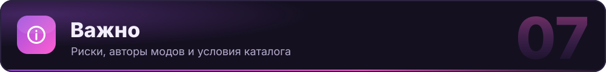

> [!WARNING]
> Изменение файлов игры делается на ваш страх и риск (так же предупреждают Dota2PornFx и Minify).

> [!IMPORTANT]
> Моды принадлежат их авторам ([список](https://github.com/h6rd/Dota2PornFxWeb#credits)).
> Не выдавайте их за свои и не продавайте.

> [!CAUTION]
> По [условиям Dota2PornFx](https://github.com/h6rd/Dota2PornFxWeb#attribution--reuse) сторонние
> приложения, которые подключаются к каталогу, требуют письменного разрешения владельца (h6rd).
> DotaCat сделан для личного использования. Если захотите выложить его публично или раздавать,
> сначала получите разрешение (Discord `.hrdq`, `hrdq@proton.me`). Подход к сборке VPK взят
> из Minify (GPL-3.0), поэтому при публикации кода учитывайте и эту лицензию.

<br>

<div align="center">
  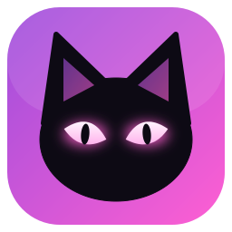
  <br>
  <sub><b>DotaCat</b> · моды Dota 2 в один клик · <a href="#top">наверх ↑</a></sub>
</div>
